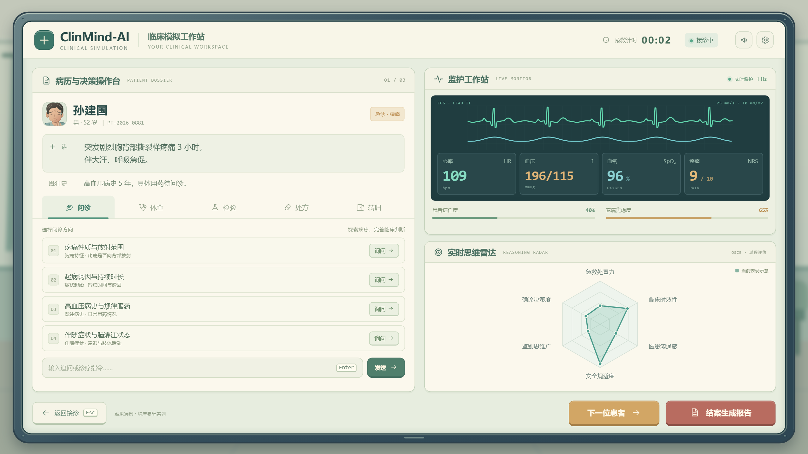

# ClinMind-AI

> **因果图谱与生理演化双核驱动的虚拟标准化病人与临床思维 OSCE 实训系统**
> Virtual Standardized Patient & Clinical Reasoning OSCE Trainer — powered by causal knowledge graph and dynamic physiology engine.

[]()
[](https://www.python.org/)
[](https://fastapi.tiangolo.com/)
[](LICENSE)

## 📸 界面概念

| 接诊场景 | 电脑工作站 |
|:---:|:---:|
|  |  |

*更多设计稿与交互原型见 [`output/ui-concepts/`](output/ui-concepts/)。*

---

## 🌟 项目简介

ClinMind-AI 面向医学生临床思维教学与 OSCE（客观结构化临床考试）实训场景，摒弃通用大模型"套皮问诊"模式，构建了一个**具备完整临床病理演化闭环**的虚拟标准化病人系统：

学员以接诊医生身份进入高保真急诊抢救室工作台，通过**语音/文本问诊、目标查体、检查开立、药物处方**等操作接诊虚拟患者；系统在医学知识的刚性约束下实时推演病情演化，并在结案后输出**白盒化的思维拓扑复盘报告**。

### 四大核心机制

1. **🧠 多 Agent 医患认知博弈** — 患者、家属、责任护士三个智能体各自拥有独立行为模型：患者搭载信任动力学方程，同理心沟通才能解锁隐藏停药史；家属会焦虑打断；护士执行医嘱队列并对危急值主动报警。
2. **🛡️ 双轨制 Graph-RAG 防幻觉护栏** — 对话渲染轨（Track A）与客观检查硬隔离轨（Track B）物理隔绝，心电图、心肌酶谱、D-二聚体、CTA 等检查结果由权威标准字典刚性输出，杜绝 LLM 捏造数字。
3. **❤️ 动态病理生理演化状态机** — 以 1Hz 连续差分动力学推演血流动力学向量（HR / SBP / DBP / SpO₂ / RR 等）；规范降压可稳定病情，致命互斥处方（如对主动脉夹层误用双抗+溶栓）会即刻触发破裂倒计时与心包压塞致死链。
4. **📊 基于图编辑距离（GED）的 OSCE 白盒评估** — 将学员操作流实时转换为决策 DAG，与专家金标准拓扑图计算图编辑距离，生成六维能力雷达图，并智能归因"锚定偏倚、过早闭环、隧道视野、漏诊误治"四大临床思维缺陷。

---

## 🚀 快速开始

系统采用零外部破坏性依赖设计，无需数据库或构建环境，开箱即用。

### 1. 安装依赖

确保已安装 Python 3.10+：

```bash
cd ClinMind-AI_完整源代码包/ClinMind-AI_完整源代码包/aic_mech
pip install -r requirements.txt
```

### 2. 一键启动

```bash
python main.py
```

启动后浏览器访问 **http://127.0.0.1:8000**，即可进入急诊抢救室工作台，开始接诊 52 岁剧烈撕裂样胸痛患者。

### 3. 运行自动化测试

```bash
python tests/run_all_tests.py
```

共 36 项自动化测试用例（预期 36 Passed / 0 Failed），并输出模块覆盖率报告。

### 4. LLM 配置（可选）

系统默认支持**离线模式**运行（无需任何 API Key）。如需接入在线大模型增强对话表现：

```bash
cp .env.example .env   # 然后编辑 .env 填入你的 API Key
```

支持 DeepSeek / OpenAI 兼容接口，详见 [`.env.example`](ClinMind-AI_完整源代码包/ClinMind-AI_完整源代码包/aic_mech/.env.example)。

> ⚠️ `.env` 含真实密钥，已被 `.gitignore` 排除，请勿提交或分享。

---

## 📂 仓库结构

```
ClinMind-AI/
├── 01-接诊场景.png / 02-电脑工作站.png   # 界面概念图
├── output/ui-concepts/                    # UI 概念设计稿（HTML/PNG/设计说明）
└── ClinMind-AI_完整源代码包/
    └── ClinMind-AI_完整源代码包/
        └── aic_mech/                      # 完整源代码
            ├── app/                       # FastAPI 后端
            │   ├── api/                   #   RESTful 接口 + WebSocket 实时广播
            │   ├── core/                  #   四大核心引擎（生理演化/防幻觉护栏/多Agent/GED评估）
            │   ├── data/                  #   病例与专家金标准知识图谱
            │   └── models/                #   Pydantic 数据模型
            ├── static/                    # 沉浸式前端（HTML5/CSS3/Vanilla JS，Canvas 心电波形）
            ├── tests/                     # 36 项自动化测试
            ├── config.py                  # 全局配置中心
            ├── main.py                    # 一键启动入口
            └── requirements.txt           # 依赖清单
```

## 🧰 技术栈

| 层级 | 技术 |
|------|------|
| 后端 | Python · FastAPI · Uvicorn · Pydantic · NetworkX · NumPy |
| 实时通信 | WebSocket（1Hz 生命体征遥测与危急值推送） |
| 前端 | HTML5 Canvas（60fps 心电/血氧波形）· ECharts（思维 DAG 与雷达图）· Web Audio API（监护仪警报音） |
| 大模型 | DeepSeek / OpenAI 兼容接口（可选，默认离线模式） |

---

## 📄 许可证

本项目基于 [MIT License](LICENSE) 开源。

## ⚠️ 免责声明

本项目为教学实训用途的模拟系统，所有病例、人物、数据均为虚构，不构成任何真实医疗建议，不可用于真实临床决策。
